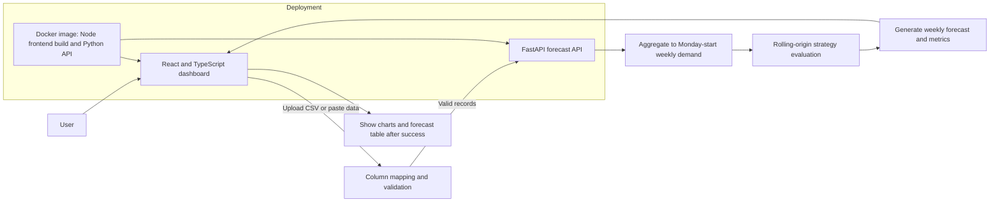

# DemandStudio

## Project Overview

DemandStudio is a weekly store-demand forecasting application. Users can upload a sales CSV, map its date, demand, and optional store/group columns, and explore historical sales alongside a forecast in an interactive dashboard.

The React frontend and FastAPI backend can run together as one Docker web service. Forecasting uploaded data does not depend on a bundled dataset or pre-trained model.

## Problem Statement

Sales data is often spread across rows of daily transactions and multiple stores. It can be difficult to turn that history into a consistent weekly view, compare demand between periods, and estimate what may come next.

## Objective

- Provide a simple way to import sales data from CSV.
- Validate that each store or group has usable, continuous weekly history.
- Aggregate daily transactions into Monday-start weekly totals.
- Generate configurable weekly forecasts and summarize historical backtest performance.
- Display the results in a dashboard that keeps analytics hidden until a forecast completes successfully.

## Solution and Flowchart (Architecture)



The Vite development server proxies `/api` requests to FastAPI during local development. For a single-service deployment, the Docker image builds the frontend and FastAPI serves the built dashboard and API from the same host.

## Key Features

- Import CSV files or paste tab-separated/spreadsheet data.
- Map date, demand, and optional store/group columns.
- Validate dates, numeric non-negative demand, row limits, group limits, minimum history, and missing weeks before forecasting.
- Aggregate multiple transactions in a week to Monday-start weekly totals.
- Forecast between 1 and 52 weeks ahead for up to 500 groups and 100,000 input records.
- Compare forecast strategies with rolling-origin backtesting when sufficient history is available.
- Explore historical and forecast demand with weekly, monthly, and yearly views, summaries, comparisons, and per-store breakdowns.
- Keep charts, analytics, and forecast tables hidden until a forecast succeeds.
- Download the generated forecast as a CSV.
- Deploy the dashboard and API together using Docker.

## Technology Stack

| Area | Technologies |
| --- | --- |
| Frontend | React 18, TypeScript, Vite |
| Backend/API | Python 3.11, FastAPI, Uvicorn |
| Data processing | pandas, NumPy |
| Forecasting | scikit-learn, joblib |
| Testing | Python `unittest`, FastAPI `TestClient`, TypeScript build |
| Deployment | Docker, Render Web Service |

## Project Structure

```text
.
├── app.py                         # FastAPI routes and forecast request handling
├── forecasting.py                 # Weekly features, strategies, and backtesting
├── generate_dataset.ipynb          # Optional model training/evaluation notebook
├── requirements.txt                # Backend runtime dependencies
├── requirements-dev.txt            # Backend test dependencies
├── Dockerfile                       # Combined frontend build and API service
├── .dockerignore                    # Files excluded from Docker build context
├── data/                            # Local training datasets (not committed)
├── artifacts/                       # Generated model bundles (not committed)
├── tests/
│   └── test_forecasting_api.py
├── Frontend/
│   ├── src/
│   │   ├── components/
│   │   ├── lib/
│   │   └── App.tsx
│   ├── package.json
│   └── vite.config.ts
└── .github/workflows/ci.yml         # Backend and frontend CI checks
```

## Project Demonstrates

- Importing and validating user-provided data before processing.
- Transforming daily transactions into continuous weekly time series.
- Comparing forecasting strategies with rolling-origin validation.
- Building and consuming a typed JSON API.
- Presenting forecast results and evaluation metrics in an interactive dashboard.
- Packaging a frontend and backend into one Docker-based web deployment.
- Automating backend tests and frontend builds with GitHub Actions.

## Project Feature Status

| Feature | Status | Notes |
| --- | --- | --- |
| CSV upload and pasted data | Complete | CSV files and spreadsheet text are supported. |
| Data mapping and validation | Complete | Requires at least 65 consecutive weeks for each group. |
| Custom weekly forecasting | Complete | Works from uploaded data without a saved model bundle. |
| Dashboard and forecast export | Complete | Analytics are shown after successful forecast generation. |
| Saved-model endpoints | Optional | `/stores` and `GET /forecast` require a generated model bundle. |
| Single-service Docker deployment | Configured | Dockerfile is ready for a Docker web service deployment. |
| Live hosted website | Not included | Create/deploy the service from the GitHub repository to publish it. |
| External factors in forecasting | Not implemented | Promotions, prices, weather, and planned holidays are not modeled. |

## Run Locally

Requirements: Python 3.11, Node.js 20+, and npm.

Install the backend dependencies from the project root:

```powershell
python -m venv .venv
.\.venv\Scripts\Activate.ps1
python -m pip install -r requirements.txt
```

Start the API in one PowerShell terminal:

```powershell
python -m uvicorn app:app --reload --host 127.0.0.1 --port 8000
```

Start the frontend in a second terminal:

```powershell
Set-Location .\Frontend
npm ci
npm run dev
```

Open the Vite URL printed in the terminal (usually `http://localhost:5173`). The development server proxies `/api` requests to FastAPI at port 8000. API health and interactive documentation are available at `http://127.0.0.1:8000/health` and `http://127.0.0.1:8000/docs`.

The frontend defaults to the local `/api` proxy. To use a different API URL, create `Frontend/.env.local` with `VITE_API_BASE_URL=<your-api-base-url>`. Do not commit `.env.local` or put secrets in frontend `VITE_*` variables.

## Deploy as One Website

1. In Render, create a **Web Service** and connect this GitHub repository.
2. Choose **Docker** as the runtime and use the root `Dockerfile`.
3. Deploy the service. The dashboard is served at `/`, and the API health check is at `/health`.

No separate frontend and backend services are needed. Forecasting uploaded CSV files does not require a saved model. To use the optional saved-model endpoints after deployment, generate `artifacts/demand_forecasting_bundle.joblib` from your own dataset and include it in the deployment image.

## Data and Forecast Notes

Upload a CSV from the dashboard, or place a local training CSV in `data/` and set `DATA_FILE`, `DATE_COLUMN`, `DEMAND_COLUMN`, and the optional `GROUP_COLUMN` in the notebook's first code cell.

Each group needs at least 65 consecutive weekly observations, with no missing weeks. CSV inputs can contain up to 100,000 records and 500 groups. The notebook can create `artifacts/demand_forecasting_bundle.joblib` for the optional saved-model endpoints. Forecasts use demand history and calendar features only; they do not currently model promotions, planned holidays, prices, weather, or other future variables. Backtest performance describes historical results and does not guarantee future accuracy.

Datasets, generated model bundles, environment files, caches, and compiled frontend assets are excluded from Git. Keep private or third-party data local.

## Learning Outcomes

- Designing and validating a forecasting workflow for grouped time-series data.
- Using rolling-origin backtesting to compare forecast strategies.
- Connecting a React/TypeScript frontend to a Python API.
- Building usable data import, validation, visualization, and export flows.
- Packaging and deploying a full-stack application with Docker.
- Testing API behavior and automating checks with continuous integration.

## Developed By

**trimannjeet**
GitHub: [@trimannjeet](https://github.com/trimannjeet)

## Conclusion

DemandStudio brings sales-data preparation, weekly forecasting, and interactive exploration into one application. It is designed to work with user-provided CSV data and can be deployed as one web service, while keeping local datasets and generated model artifacts out of the public repository.

## Validate Changes

Run backend tests:

```powershell
python -m pip install -r requirements-dev.txt
python -m unittest discover -s tests -v
```

Build the frontend:

```powershell
Set-Location .\Frontend
npm ci
npm run build
```

These checks also run in GitHub Actions on pushes and pull requests.
